<div dir="rtl" align="center">


# مصاريفي · Masarifi

**تطبيق لإدارة مصاريفك: إدخال يدوي، ميزانيات، تحليل، فواتير ونسخ احتياطي، وبياناتك تظل في تلفونك. ومع البنوك العُمانية تتسجّل مصاريفك بروحها من رسائل البنك.**

[](https://github.com/al3nkboot/masarifi/releases)
[](https://github.com/al3nkboot/masarifi/releases)

[](https://paypal.me/Midroid5G)
[](https://x.com/midroid5G)

### [⬇️ تحميل التطبيق (APK)](https://github.com/al3nkboot/masarifi/releases)

الإصدار الحالي **2.7.0** — بنسختين:

| | النسخة الكاملة `masarifi-v2.7.0.apk` | بدون الرسائل `masarifi-v2.7.0-nosms.apk` |
|---|---|---|
| قراءة رسائل البنك وتسجيل المصاريف تلقائياً | ✅ | ❌ (إدخال يدوي) |
| صلاحية الرسائل SMS | تطلبها | لا تطلبها أبداً |
| باقي المزايا (الفواتير، الضمانات، النسخ الاحتياطي…) | ✅ | ✅ |

**Two editions / نسختان:** *Full* reads bank SMS to log expenses automatically; *No-SMS* has no SMS permission at all (manual entry). Both share the same package and data, so installing one replaces the other and keeps your data. / النسختان بنفس الحزمة والبيانات: تثبيت واحدة يستبدل الأخرى وتبقى بياناتك.

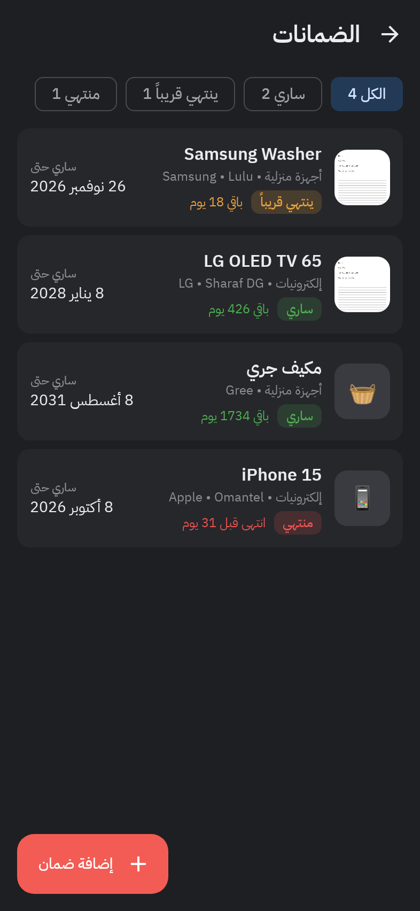 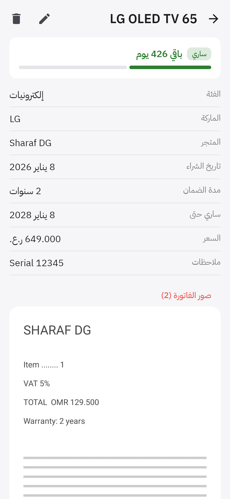 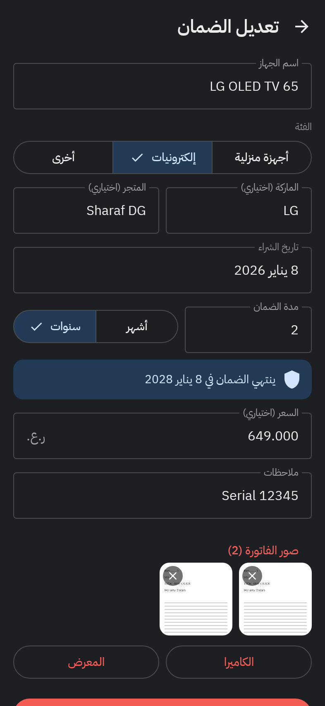

### الجديد في 2.7.0

<div dir="rtl">

- أهداف الادخار: هدف بمبلغ وموعد، ونسبة تقدم، وكم تحتاج تدخر كل شهر، وأقرب هدف في الصفحة الرئيسية.
- الديون وتقسيم المصاريف: اللي أقرضته واللي عليك، وتسديد جزئي أو كامل، وتقسيم فاتورة مشتركة على أصحابك.
- صافي الثروة: حسابات للاستثمارات وللقروض والائتمان، والقروض تنخصم من مجموعك.
- تقارير أسرع: هذا الأسبوع وهذا الشهر وآخر ثلاثة أشهر وهذه السنة، مع أكثر المتاجر صرفاً ونسبة الادخار.
- فلاتر سريعة في قائمة العمليات، وزر لتكرار أي عملية سابقة.

</div>

**What's new:** savings goals with progress and a home card · debts/IOUs with partial settlement and bill splitting · net worth with Investment and Loan/credit account types · quick report periods (this week / this month / last 3 months / this year), top merchants and savings rate · quick type filters on the transaction list and a duplicate-transaction action.

### الجديد في 2.6.3 / What's new
- ترحيل الرصيد (اختياري، متوقف افتراضياً): المتبقي أو العجز من الشهر السابق يظهر في تبويب المعاملات دون إنشاء عملية — Optional balance carry-over (off by default) shows last month's signed remainder on the Transactions tab; it is not stored as a transaction and is left out of Stats
- حذف حساب دون حذف معاملاته: نقلها إلى حساب آخر، أو إلى سلة قابلة للاستعادة، والحذف النهائي يحتاج تأكيداً ثانياً — Delete an account without wiping its transactions (move them, or soft-delete to a restorable bin; wiping needs a second confirm)
- دمج حسابين مع الإبقاء على الرصيد الافتتاحي للحساب الهدف — Merge accounts, keeping the target's opening balance
- وضع تعديل للحسابات مع سحب للترتيب، وإخفاء حساب، وتفاصيل الحساب مع رصيد جارٍ — Accounts edit mode with drag-to-reorder, hide account, and a running balance on the account detail

- صفحة «الفئات» بأسلوب Money Manager: زر حذف أحمر، الإيموجي والاسم مع عدد الفئات الفرعية وأسمائها، قلم للتعديل، ومقبض ≡ للسحب وتغيير الترتيب — Money Manager-style categories: red delete, emoji + name + subcategory count, pencil, drag handle to reorder
- الضغط على فئة يعرض فئاتها الفرعية مع «إضافة فئة فرعية»، ويمكن ترتيبها بالسحب أيضاً — Tap a category to open its subcategories (add / edit / delete / drag)
- حذف فئة فرعية ينقل معاملاتها إلى الفئة الرئيسية بدلاً من تركها بلا فئة — Deleting a subcategory keeps its transactions on the parent
- إصلاح لمرة واحدة: المعاملات المستوردة من Money Manager قبل 2.6.1 تُنقل إلى فئتها الفرعية عند تطابق مؤكد، مع إمكانية التراجع — One-time, undoable repair moves pre-2.6.1 Money Manager imports onto their subcategory when the match is unambiguous; re-importing the same file fixes the rest exactly

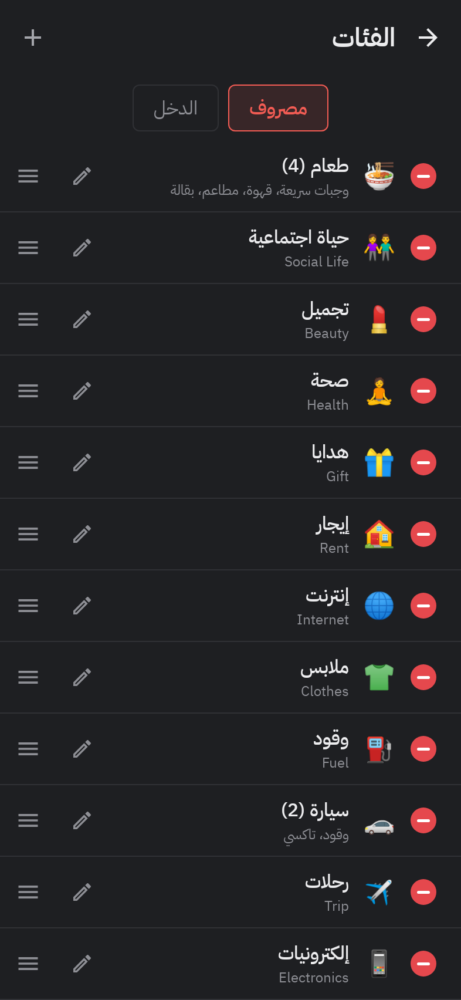 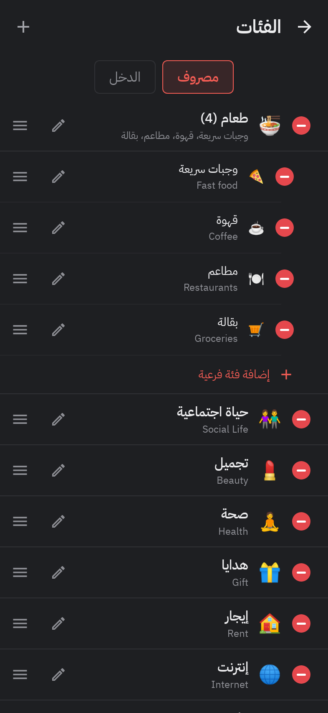 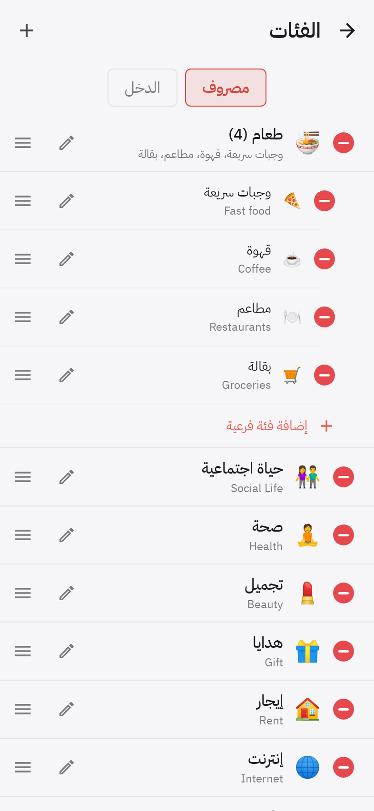

### الجديد في 2.6.1 / What's new
- فئات Money Manager الفرعية تُستورد كفئات فرعية حقيقية، ونقل الإيموجي من بداية الاسم — Money Manager subcategories imported as real subcategories; leading emoji moved out of names

### الجديد في 2.6.0 / What's new
- عملات كل دول الجامعة العربية + قائمة عملة قابلة للتمرير — Currencies for all Arab League countries; scrollable currency list
- التحقق من التحديثات وصفحة التطبيق في «المزيد» عبر GitHub Releases — Check for updates + app page link in More (GitHub Releases)
- صلاحية الإنترنت فقط لهذا التحقق اليدوي — `INTERNET` only for that manual check

### الجديد في 2.5.0 / What's new
- الضمانات للأجهزة المنزلية والإلكترونيات مع حساب تاريخ الانتهاء وحالة (ساري / ينتهي قريباً / منتهي) — Warranties for appliances & electronics with expiry status
- صور الفاتورة من الكاميرا أو المعرض، مع عرض مكبّر — Invoice photos from camera or gallery, zoomable viewer
- تنبيه قبل انتهاء الضمان بـ 30 و 7 أيام — Reminders 30 and 7 days before expiry
- النسخ الاحتياطي يشمل الضمانات وصورها — Backup includes warranties and their photos
- زر الإضافة في تبويب «يومي» صار في المنتصف حتى لا يغطي المبالغ — Centred Add button on the Daily tab

### 2.4.0

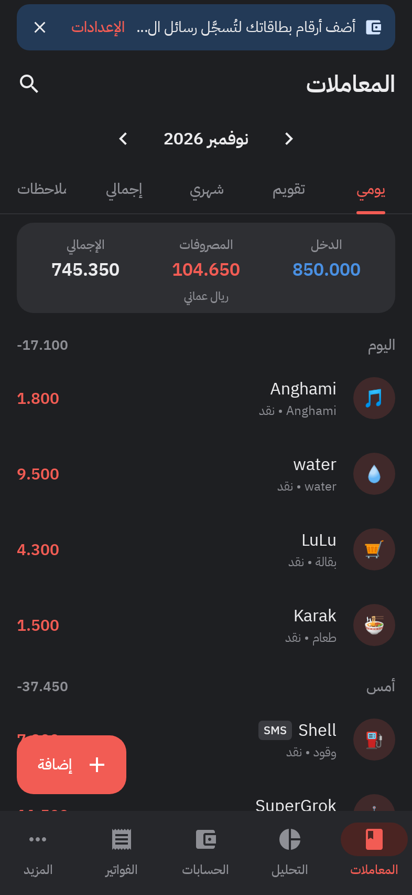 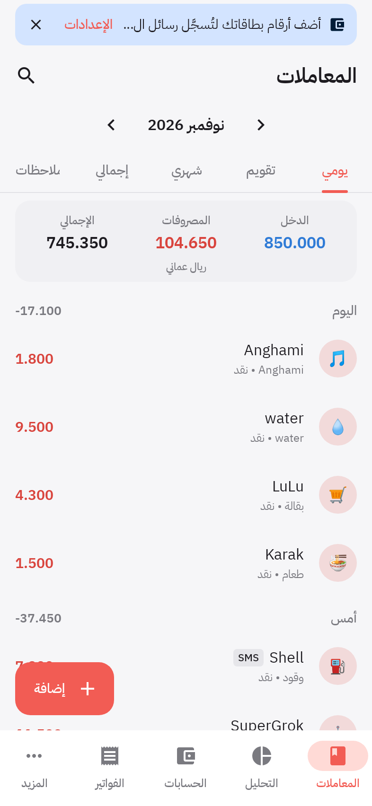 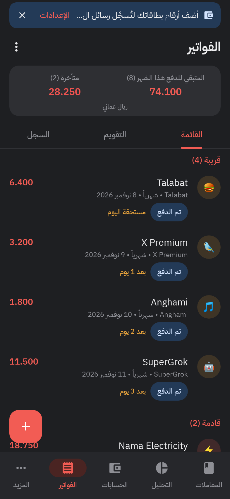 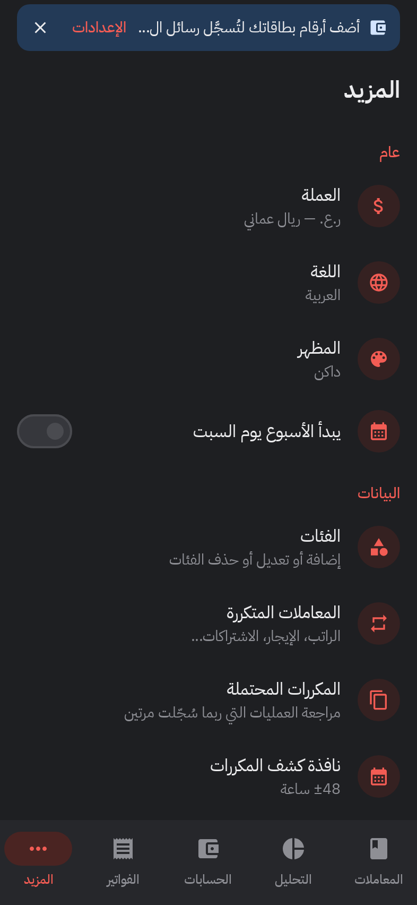 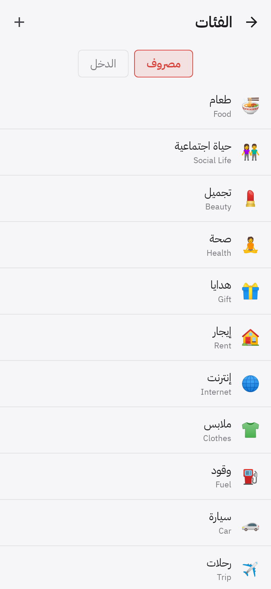

<sub>الرئيسية (داكن/فاتح) · الفواتير · المزيد · الفئات. كل البيانات في الصور وهمية.</sub>

### الجديد في 2.4.0 / What's new
- تصميم Material 3 أنظف بنظام tokens موحّد للخطوط والمسافات والأشكال — Cleaner Material 3 with design tokens
- خط IBM Plex Sans Arabic (رخصة OFL) بأرقام جدولية — IBM Plex Sans Arabic (OFL), tabular figures
- 5 تبويبات ثابتة بأسماء قصيرة: يومي · تقويم · شهري · إجمالي · ملاحظات — Fixed 5 tabs with short labels
- زر «تم الدفع» انتقل تحت عنوان الفاتورة — Bill "Paid" button moved under the title
- أيقونات فئات ذكية حسب الاسم — Keyword-based category icons
- زر FAB ينكمش عند التمرير — Collapsing FAB

[English](#english)

</div>

<div dir="rtl">

## المزايا

تطبيق أندرويد لإدارة المصاريف على طريقة Money Manager، بثيم داكن وواجهة عربية (والإنجليزية متوفرة). تسجّل عملياتك يدويًا أو تلقائيًا من رسائل البنك. عملة واحدة للتطبيق تختارها من الإعدادات: الريال العُماني (الافتراضي)، الدرهم الإماراتي، الريال السعودي، الدينار الكويتي، الدينار البحريني، الريال القطري، الدولار، اليورو، أو الروبية الهندية. لا يدعم حاليًا عدة عملات في نفس الوقت.

### 📩 تسجيل تلقائي من رسائل البنك (البنوك العُمانية حاليًا)
- يقرأ رسائل SMS من البنوك العُمانية فقط حاليًا ويحوّلها إلى عمليات، مع قواعد قابلة للتعديل.
- يربط كل بطاقة بحسابها (البنك + آخر 4 أرقام).
- يدمج الرسالتين المكررتين لنفس العملية، ويسجّل التحويل بين حساباتك عملية تحويل واحدة، والسحب من الصراف تحويلًا إلى النقد.
- أداة «إصلاح العمليات التلقائية» لمراجعة العمليات القديمة وتصحيحها مع إمكانية التراجع.

### 📊 الميزانية والتحليل
- ميزانية شهرية وميزانية لكل فئة، مع تنبيهات عند 80% و100%.
- إحصائيات ورسوم بيانية وملخص مالي ونصائح حول إنفاقك، وتنبيه عند ارتفاع مفاجئ في المصروف.

### 🧹 بيانات مرتبة
- كشف التكرار بين ما تسجّله يدويًا وما يصل من رسائل البنك، مع شاشة لمراجعة المكررات المحتملة.
- تحديد عدة عمليات وحذفها مرة وحدة، مع زر «تراجع».
- عمليات متكررة (راتب، اشتراكات…).
- استيراد بياناتك من تطبيق Money Manager ‏(xlsx/CSV).

### ☁️ نسخ احتياطي ومزامنة عبر Google Drive
- نسخ احتياطي يومي تلقائي إلى مجلد تختاره في Drive، ويحتفظ بآخر 10 نسخ.
- مزامنة جهازين عن طريق ملف واحد مشترك في Drive.

### 🎯 الأهداف والديون وصافي الثروة
- أهداف ادخار بنسبة تقدم وموعد، وأقرب هدف يظهر في الرئيسية.
- سجل للديون: اللي لك واللي عليك، مع التسديد وتقسيم المصاريف المشتركة.
- صافي الثروة: الأصول ناقص القروض والبطاقات المدينة.

### 🧾 الفواتير (تجريبي في 2.1)
- فواتير متكررة (شهرية، سنوية، أو كل عدة أشهر) مع تذكير قبل موعدها.
- زر «تم الدفع» يسجّل المصروف مباشرة، ويعرض دمجه مع رسالة البنك إن وُجدت.
- تقويم للفواتير وسجل للدفعات، وودجت على الشاشة الرئيسية.

## البنوك المدعومة

| البنك | الحالة |
|---|---|
| بنك مسقط (وميثاق) | قواعد مخصصة: مشتريات البطاقة، التحويل عبر الجوال، الخصم والإيداع |
| ثواني – بطاقة موجب | قواعد مخصصة: مشتريات البطاقة |
| بنك ظفار (وميسرة) | قواعد مخصصة للرسائل العربية: الخصم والإيداع |
| البنك الوطني العماني، صحار الدولي، بنك عمان العربي، HSBC عُمان، البنك الأهلي، بنك نزوى، العز الإسلامي | يتعرّف على المرسل ويطبّق القواعد العامة. لم تُختبر على رسائل حقيقية بعد |

التسجيل التلقائي يدعم حاليًا البنوك العُمانية فقط. بنكك من دولة ثانية، أو مو في القائمة، أو رسائله ما تنقرأ صح؟ شوف قسم [ساهم](#ساهم). باقي مزايا التطبيق تشتغل بدون رسائل البنك.

## الخصوصية

- **لا يوجد خادم ولا إعلانات ولا تتبّع.** صلاحية الإنترنت تُستخدم فقط لما تطلب «التحقق من التحديثات» (استعلام GitHub العام).
- بياناتك محفوظة في تلفونك فقط. النسخ الاحتياطي والمزامنة يكتبان ملفًا في **حسابك أنت** على Google Drive عن طريق منتقي الملفات في النظام، بدون تسجيل دخول داخل التطبيق.
- الصلاحيات المطلوبة: قراءة واستقبال الرسائل (للتسجيل التلقائي)، والإشعارات (للتنبيهات والتذكيرات).
- أرقام البطاقات التي تربطها في الإعدادات تُحفظ على الجهاز فقط.
- التفاصيل: [سياسة الخصوصية](docs/privacy-policy.md).

## التثبيت

1. حمّل ملف `masarifi-<الإصدار>-release.apk` من [صفحة الإصدارات](https://github.com/al3nkboot/masarifi/releases). المتطلب: أندرويد 8.0 أو أحدث.
2. افتح الملف واسمح بـ«تثبيت التطبيقات من مصادر غير معروفة» للمتصفح أو مدير الملفات.
3. **تحذير Play Protect:** لأن التطبيق يطلب صلاحية الرسائل ولم يُنشر في Google Play، قد يظهر تحذير أو يُحظر التثبيت. اضغط «مزيد من التفاصيل» ← «التثبيت على أي حال». قد تختلف الأسماء حسب الجهاز.
4. افتح التطبيق واسمح بصلاحية الرسائل والإشعارات. إذا رفض أندرويد منح صلاحية الرسائل («إعداد محظور»): الإعدادات ← التطبيقات ← مصاريفي ← ⋮ ← «السماح بالإعدادات المحظورة»، ثم فعّلها.
5. من الإعدادات اربط بطاقاتك بحساباتك، ويمكنك استيراد الرسائل القديمة.

## ساهم

أكبر مساعدة: **عيّنات من رسائل بنكك** حتى نضيف بنوك أكثر، من عُمان أو من أي دولة ثانية. افتح [Issue جديد](https://github.com/al3nkboot/masarifi/issues/new?template=bank-sms.md) والصق نص الرسالة كما هو، بعد **إخفاء** رقم البطاقة والحساب والرصيد والأسماء (مثلًا `XXXX1234` ← `XXXX0000`).

البلاغات والاقتراحات مرحّب فيها كذلك.

### إضافة بنك (للمطوّرين)

كل البنوك في جدول واحد: `banks` في [`DefaultSmsConfig.kt`](app/src/main/java/com/midroid/masarifi/sms/DefaultSmsConfig.kt). إضافة بنك = إضافة عنصر `BankProfile` واحد بدون كود جديد:
- `senderIds` و`bodyNames`: اسم المرسل والكلمات التي تعرّف البنك في نص الرسالة.
./gradlew assembleFullDebug assembleNosmsDebug   # app/build/outputs/apk/{full,nosms}/debug/
- `debitKeywords` و`creditKeywords` (اختياري): كلمات خصم/إيداع إضافية خاصة بالبنك.

اكتب القواعد من رسالة حقيقية مُخفاة فقط (من [قالب عيّنة رسالة بنك](.github/ISSUE_TEMPLATE/bank-sms.md))، وأضف لها اختبارًا في `BankTableTest.kt`.

## البناء من المصدر

```bash
./gradlew assembleDebug        # app/build/outputs/apk/debug/app-debug.apk
./gradlew testDebugUnitTest    # الاختبارات، ومنها اختبارات لقطات الشاشة (Robolectric)
```
يتطلب Android SDK و JDK 17. التفاصيل التقنية بالإنجليزية في [`docs/README.en.md`](docs/README.en.md).

## 💙 دعم استمرارية تطوير التطبيق

إذا أعجبك التطبيق واستفدت منه، يمكنك دعم المطور **`@midroid5G`** للمساهمة في استمرار تطوير التطبيق وتحديثه مجانًا وبدون إعلانات:

- **PayPal:** [**paypal.me/Midroid5G**](https://paypal.me/Midroid5G) (`@Midroid5G`)
- **حساب X (تويتر):** [**@midroid5G**](https://x.com/midroid5G)

## الحقوق

من تطوير [@midroid5G](https://x.com/midroid5G). مبني بـ Kotlin و Jetpack Compose و Material 3 و Room و WorkManager.

© جميع الحقوق محفوظة. المشروع بدون رخصة مفتوحة حاليًا.

</div>

---

## English

**Masarifi** is an Android expense tracker in the style of Money Manager, with a dark theme. Arabic is the default language and English is available. Add transactions manually, or have them logged automatically from bank SMS. The app uses one currency, chosen in Settings: OMR (default), AED, SAR, KWD, BHD, QAR, USD, EUR or INR. Multiple currencies at once are not supported.

**Automatic SMS logging currently supports Omani banks only:** dedicated rules for Bank Muscat, Bank Dhofar and Thawani/Mojab card; other Omani banks use generic rules that haven't been tested on real messages yet. Every other feature works without bank SMS.

- Budgets with 80%/100% alerts, charts, a financial summary and spending tips.
- Duplicate detection between manual entries and SMS, multi-select delete with undo, recurring transactions, and import from Money Manager.
- Automatic daily backup to your own Google Drive (keeps the last 10 copies), plus two-device sync through one shared Drive file.
- **2.1 beta:** recurring bills with reminders, a "Paid" button that records the expense, a bills calendar and a home-screen widget.
- **Privacy:** there's no server and no ads. `INTERNET` is used only for the optional manual update check against GitHub. Your data stays on your phone and in your own Drive. See the [privacy policy](docs/privacy-policy.md).

**[Download the APK from Releases](https://github.com/al3nkboot/masarifi/releases)** (Android 8.0+). Play Protect may warn you because the app reads SMS. Tap *More details → Install anyway*.
If your bank (from any country) isn't supported, [open an issue](https://github.com/al3nkboot/masarifi/issues/new?template=bank-sms.md) with a **masked** sample SMS.
To add a bank in code: add one `BankProfile` entry (sender IDs, `SmsRule` regexes using `{AMT}` `{CUR}` `{MERCHANT}` `{CARD}` `{DATE}`, optional debit/credit keywords) to `banks` in [`DefaultSmsConfig.kt`](app/src/main/java/com/midroid/masarifi/sms/DefaultSmsConfig.kt), based only on a real masked sample ([template](.github/ISSUE_TEMPLATE/bank-sms.md)), plus a test in `BankTableTest.kt`.
- **Support development:** [**PayPal (@Midroid5G)**](https://paypal.me/Midroid5G) · [**@midroid5G on X**](https://x.com/midroid5G)

Technical docs: [docs/README.en.md](docs/README.en.md). © All rights reserved. No open-source license has been granted.
