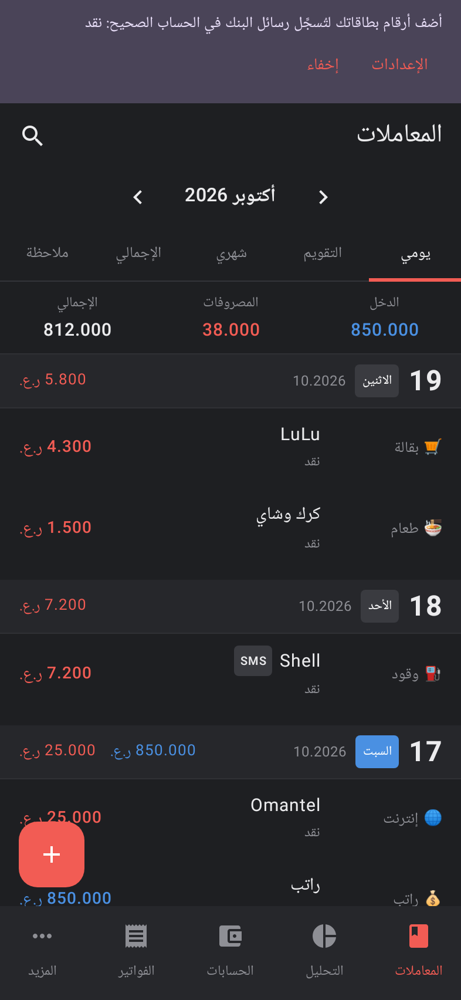
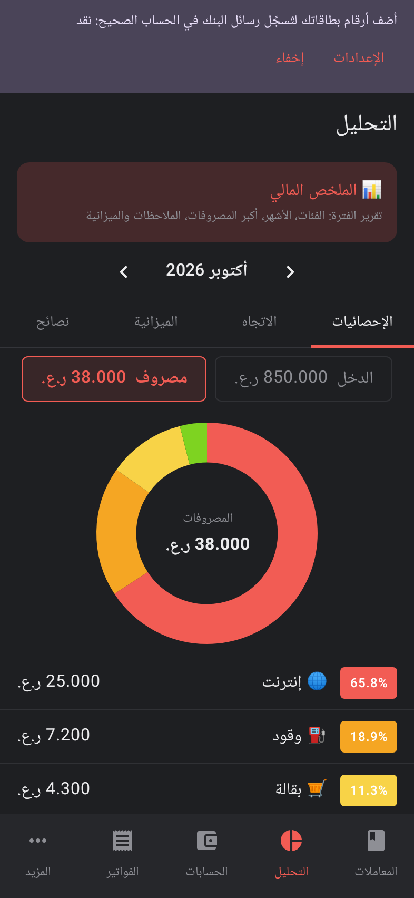
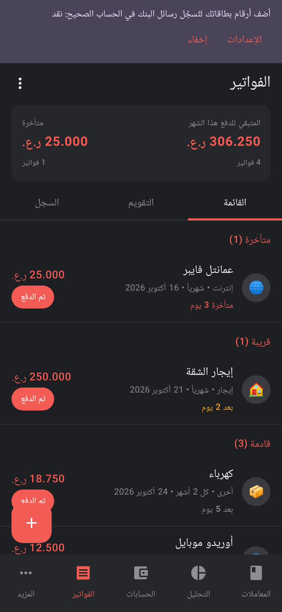
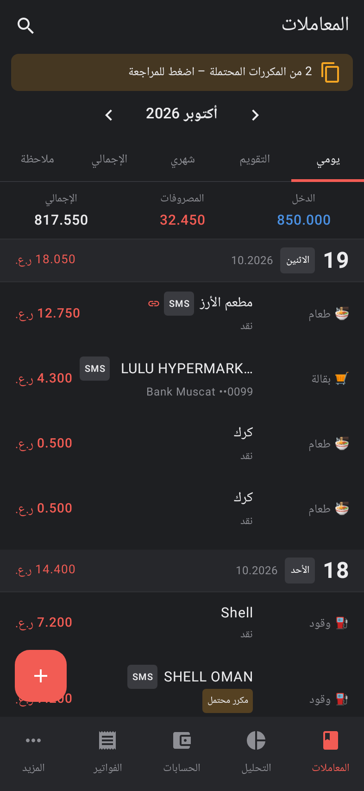

<div dir="rtl" align="center">


# مصاريفي · Masarifi

**مصاريفك تتسجّل بروحها من رسائل البنك. بالريال العُماني، وبياناتك تظل في تلفونك.**

[](https://github.com/al3nkboot/masarifi/releases)
[](https://github.com/al3nkboot/masarifi/releases)


### [⬇️ تحميل التطبيق (APK)](https://github.com/al3nkboot/masarifi/releases)

الإصدار المستقر **2.0.0**، والإصدار التجريبي **2.1.0** يضيف قسم «الفواتير».

   

<sub>المعاملات · التحليل · الفواتير (2.1) · عمليات مسجّلة من رسائل البنك. كل البيانات في الصور وهمية.</sub>

[English](#english)

</div>

<div dir="rtl">

## المزايا

تطبيق أندرويد لإدارة المصاريف على طريقة Money Manager، بثيم داكن وواجهة عربية (والإنجليزية متوفرة)، والعملة الافتراضية الريال العُماني بثلاث خانات عشرية.

### 📩 تسجيل تلقائي من رسائل البنك
- يقرأ رسائل SMS من البنوك العُمانية ويحوّلها إلى عمليات، مع قواعد قابلة للتعديل.
- يربط كل بطاقة بحسابها (البنك + آخر 4 أرقام).
- يدمج الرسالتين المكررتين لنفس العملية، ويسجّل التحويل بين حساباتك عملية تحويل واحدة، والسحب من الصراف تحويلًا إلى النقد.
- أداة «إصلاح العمليات التلقائية» لمراجعة العمليات القديمة وتصحيحها مع إمكانية التراجع.

### 📊 الميزانية والتحليل
- ميزانية شهرية وميزانية لكل فئة، مع تنبيهات عند 80% و100%.
- إحصائيات ورسوم بيانية وملخص مالي ونصائح حول إنفاقك، وتنبيه عند ارتفاع مفاجئ في المصروف.

### 🧹 بيانات مرتبة
- كشف التكرار بين ما تسجّله يدويًا وما يصل من رسائل البنك، مع شاشة لمراجعة المكررات المحتملة.
- تحديد عدة عمليات وحذفها مرة وحدة، مع زر «تراجع».
- عمليات متكررة (راتب، اشتراكات…).
- استيراد بياناتك من تطبيق Money Manager ‏(xlsx/CSV).

### ☁️ نسخ احتياطي ومزامنة عبر Google Drive
- نسخ احتياطي يومي تلقائي إلى مجلد تختاره في Drive، ويحتفظ بآخر 10 نسخ.
- مزامنة جهازين عن طريق ملف واحد مشترك في Drive.

### 🧾 الفواتير (تجريبي في 2.1)
- فواتير متكررة (شهرية، سنوية، أو كل عدة أشهر) مع تذكير قبل موعدها.
- زر «تم الدفع» يسجّل المصروف مباشرة، ويعرض دمجه مع رسالة البنك إن وُجدت.
- تقويم للفواتير وسجل للدفعات، وودجت على الشاشة الرئيسية.

## البنوك المدعومة

| البنك | الحالة |
|---|---|
| بنك مسقط (وميثاق) | قواعد مخصصة: مشتريات البطاقة، التحويل عبر الجوال، الخصم والإيداع |
| ثواني – بطاقة موجب | قواعد مخصصة: مشتريات البطاقة |
| بنك ظفار (وميسرة) | قواعد مخصصة للرسائل العربية: الخصم والإيداع |
| البنك الوطني العماني، صحار الدولي، بنك عمان العربي، HSBC عُمان، البنك الأهلي، بنك نزوى، العز الإسلامي | يتعرّف على المرسل ويطبّق القواعد العامة. لم تُختبر على رسائل حقيقية بعد |

بنكك مو في القائمة أو رسائله ما تنقرأ صح؟ شوف قسم [ساهم](#ساهم).

## الخصوصية

- **لا يوجد خادم ولا إعلانات ولا تتبّع.** التطبيق لا يطلب صلاحية الإنترنت أصلًا (`INTERNET` غير موجودة في الـ manifest).
- بياناتك محفوظة في تلفونك فقط. النسخ الاحتياطي والمزامنة يكتبان ملفًا في **حسابك أنت** على Google Drive عن طريق منتقي الملفات في النظام، بدون تسجيل دخول داخل التطبيق.
- الصلاحيات المطلوبة: قراءة واستقبال الرسائل (للتسجيل التلقائي)، والإشعارات (للتنبيهات والتذكيرات).
- أرقام البطاقات التي تربطها في الإعدادات تُحفظ على الجهاز فقط.

## التثبيت

1. حمّل ملف `masarifi-<الإصدار>-release.apk` من [صفحة الإصدارات](https://github.com/al3nkboot/masarifi/releases). المتطلب: أندرويد 8.0 أو أحدث.
2. افتح الملف واسمح بـ«تثبيت التطبيقات من مصادر غير معروفة» للمتصفح أو مدير الملفات.
3. **تحذير Play Protect:** لأن التطبيق يطلب صلاحية الرسائل ولم يُنشر في Google Play، قد يظهر تحذير أو يُحظر التثبيت. اضغط «مزيد من التفاصيل» ← «التثبيت على أي حال». قد تختلف الأسماء حسب الجهاز.
4. افتح التطبيق واسمح بصلاحية الرسائل والإشعارات. إذا رفض أندرويد منح صلاحية الرسائل («إعداد محظور»): الإعدادات ← التطبيقات ← مصاريفي ← ⋮ ← «السماح بالإعدادات المحظورة»، ثم فعّلها.
5. من الإعدادات اربط بطاقاتك بحساباتك، ويمكنك استيراد الرسائل القديمة.

## ساهم

أكبر مساعدة: **عيّنات من رسائل بنكك** حتى نضيف بنوك أكثر. افتح [Issue جديد](https://github.com/al3nkboot/masarifi/issues/new?template=bank-sms.md) والصق نص الرسالة كما هو، بعد **إخفاء** رقم البطاقة والحساب والرصيد والأسماء (مثلًا `XXXX1234` ← `XXXX0000`).

البلاغات والاقتراحات مرحّب فيها كذلك.

## البناء من المصدر

```bash
./gradlew assembleDebug        # app/build/outputs/apk/debug/app-debug.apk
./gradlew testDebugUnitTest    # الاختبارات، ومنها اختبارات لقطات الشاشة (Robolectric)
```
يتطلب Android SDK و JDK 17. التفاصيل التقنية بالإنجليزية في [`docs/README.en.md`](docs/README.en.md).

## الحقوق

من تطوير [@midroid5G](https://x.com/midroid5G). مبني بـ Kotlin و Jetpack Compose و Material 3 و Room و WorkManager.

© جميع الحقوق محفوظة. المشروع بدون رخصة مفتوحة حاليًا.

</div>

---

## English

**Masarifi** is an Android expense tracker in the style of Money Manager, with a dark theme and the Omani Rial (OMR) as the default currency. Arabic is the default language and English is available. It logs spending automatically from Omani bank SMS (Bank Muscat, Bank Dhofar, Thawani/Mojab card).

- Budgets with 80%/100% alerts, charts, a financial summary and spending tips.
- Duplicate detection between manual entries and SMS, multi-select delete with undo, recurring transactions, and import from Money Manager.
- Automatic daily backup to your own Google Drive (keeps the last 10 copies), plus two-device sync through one shared Drive file.
- **2.1 beta:** recurring bills with reminders, a "Paid" button that records the expense, a bills calendar and a home-screen widget.
- **Privacy:** there's no server and no ads. The app doesn't even request the `INTERNET` permission. Your data stays on your phone and in your own Drive.

**[Download the APK from Releases](https://github.com/al3nkboot/masarifi/releases)** (Android 8.0+). Play Protect may warn you because the app reads SMS. Tap *More details → Install anyway*.
If your bank isn't supported, [open an issue](https://github.com/al3nkboot/masarifi/issues/new?template=bank-sms.md) with a **masked** sample SMS.
Technical docs: [docs/README.en.md](docs/README.en.md). © All rights reserved. No open-source license has been granted.
